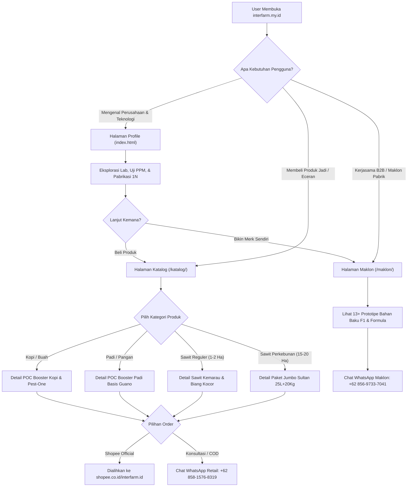
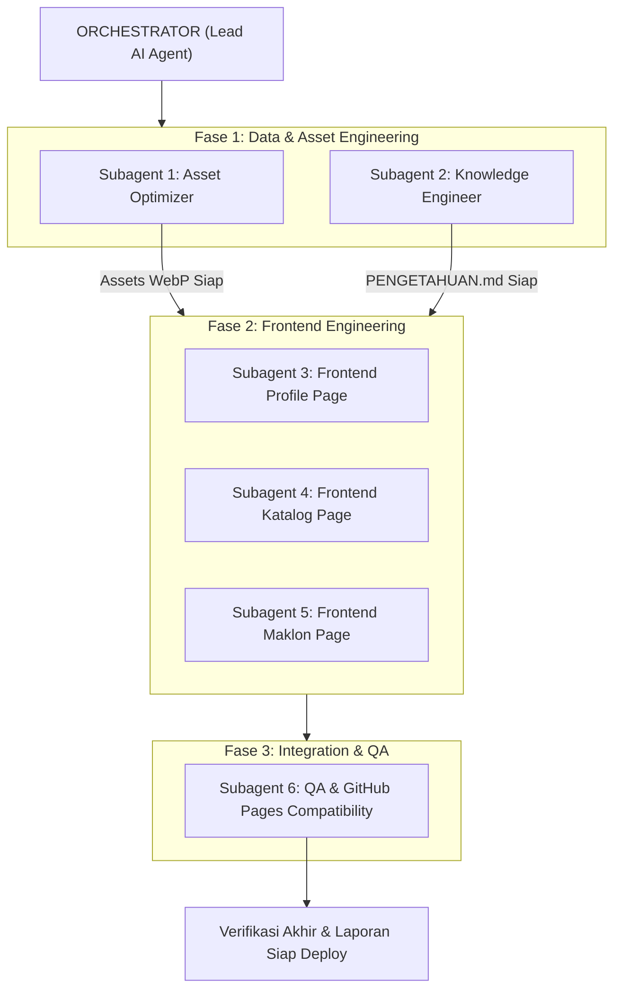

# Product Requirements Document (PRD)
# Website Resmi InterFarm (InterFarm Integrated Farming)

**Nama Produk**: Website InterFarm (Profil Perusahaan, Katalog Produk Retail, & Layanan Maklon B2B)  
**Target Domain**: `interfarm.my.id` (Hosting: GitHub Pages)  
**Status**: `DRAFT FOR USER REVIEW`  
**Author**: Lead Systems & Software Architect (Antigravity AI)  
**Tanggal**: 14 Oktober 2026  
**Direktori Kerja**: `Landingpage/`  

---

## 1. Executive Summary & Problem Statement

### 1.1 Latar Belakang (Context)
**InterFarm (Integrated Farming)** adalah produsen teknologi pertanian (*agrotech*), bio-kimia, dan laboratorium riset pertanian terkemuka di Indonesia. InterFarm memproduksi dan menyuplai bahan baku dasar F1, formula organik cair murni berkonsentrat tinggi (hingga 10.100 PPM dengan teknologi kelarutan 1N murni non-fermentasi konvensional), serta pupuk pasta pelarut pupuk kimia yang telah terbukti meningkatkan hasil panen dan memutus siklus gagal panen / musim trek.

Saat ini, aset pemasaran digital InterFarm tersebar dalam materi gambar, video, toko Shopee, serta beberapa kanal WhatsApp customer service yang berbeda fungsinya:
1. **WhatsApp Retail / Produk Jadi (+62 858-1576-8319)** untuk petani akhir dan perkebunan swasta yang ingin membeli paket ritel (Kopi, Padi/Pangan, Paket Sawit Biasa, Paket Sawit Biang Kocor 2 Ha, Paket Sawit Jumbo 15-20 Ha).
2. **WhatsApp Maklon / B2B (+62 856-9733-7041)** untuk pemilik perkebunan skala besar, pemilik merek pupuk, distributor, kios pertanian, atau investor yang ingin mendirikan pabrik pupuk sendiri dengan formula maklon InterFarm (*white-label / private label*).
3. **Official Store Shopee (`https://shopee.co.id/interfarm.id`)** sebagai kanal transaksi marketplace dengan jaminan COD dan pilihan ekspedisi resmi.

### 1.2 Masalah yang Dihadapi (Problem Statement)
1. **Pemisahan Audiens Belum Jelas**: Calon mitra maklon B2B dan pembeli ritel sering kali tercampur saluran komunikasinya, menyebabkan proses konsultasi tidak efisien dan konversi sales tertunda.
2. **Ketiadaan Rumah Digital Terpusat**: Belum ada website resmi dengan domain representatif (`interfarm.my.id`) yang menampilkan kredibilitas pabrik, spesifikasi teknis produk, dosis pemakaian terukur, dan portofolio prototipe maklon.
3. **Ukuran Aset Gambar Terlalu Berat**: Aset gambar promosi dan label produk saat ini berformat PNG resolusi tinggi dan video berukuran puluhan megabyte (~80MB total). Jika diunggah langsung ke GitHub Pages tanpa kompresi WebP, performa loading website di wilayah perkebunan dengan sinyal 3G/4G terbatas akan lambat.
4. **Struktur Folder Belum Terstandarisasi**: Penamaan folder materi saat ini mengandung spasi panjang (contoh: `paket sawit kasiat sama dengan sawit biasa tapi ukuran lebih kecil`), yang rentan bermasalah pada URL server static GitHub Pages / Linux environment.

### 1.3 Solusi yang Diusulkan (Proposed Solution)
Membangun web portal statis modern yang ringan, cepat, elegan, dan mobile-first untuk InterFarm, di-host pada GitHub Pages dengan custom domain `interfarm.my.id`. Website ini memiliki arsitektur navigasi multi-halaman yang bersih:
- **Halaman Profil (`/` atau `index.html`)**: Membangun *brand authority*, mengenalkan teknologi agrikultur InterFarm, keunggulan laboratorium, uji kemurnian PPM meter, sertifikasi/jaminan keaslian, dan navigasi cepat.
- **Halaman Katalog (`/katalog/` atau `katalog/index.html`)**: Menampilkan katalog lengkap produk jadi ritel (Pupuk POC Booster Kopi, POC Booster Padi/Pangan Berbasis Guano, Paket Sawit Biasa/Kemarau, Paket Sawit Biang Kocor 2 Ha, Paket Jumbo Sultan 15-20 Ha, Fruit Expand, Pest-One) lengkap dengan kalkulator/tabel dosis pemakaian, tombol COD/Shopee, dan tombol konsultasi WhatsApp Retail.
- **Halaman Maklon (`/maklon/` atau `maklon/index.html`)**: Landing page khusus B2B yang menawarkan jasa maklon pupuk cair/padat/pasta, penyediaan 13+ prototipe bahan baku aktif F1, konsultasi pendirian pabrik mini kebun, dan tombol direct WhatsApp Maklon.

---

## 2. Goals & Non-Goals

### 2.1 Goals Utama
1. **Separasi Jalur Komunikasi WhatsApp 100% Akurat**:
   - Seluruh CTA tombol di Halaman Katalog diarahkan ke WhatsApp Produk Jadi: `+62 858-1576-8319` dengan pre-filled text dinamis sesuai produk yang dilihat.
   - Seluruh CTA tombol di Halaman Maklon diarahkan ke WhatsApp Maklon & Pabrik: `+62 856-9733-7041` dengan pre-filled text format penawaran maklon.
2. **Performa Ultra Cepat (< 1.5 detik First Contentful Paint di Mobile 4G)**:
   - Seluruh gambar PNG/JPG dikompresi menjadi WebP modern (kompresi 75-85%), menghemat bandwidth hingga 70-80% tanpa penurunan ketajaman visual.
   - Menggunakan static HTML5 modern dengan Tailwind CSS (CDN/minified) dan vanilla JavaScript murni (zero-dependency, bebas bloatware framework).
3. **Struktur URL & Folder Bersih Siap GitHub Pages**:
   - Folder dirapikan menjadi struktur URL SEO-friendly:
     - Root: `index.html` (Profile)
     - Subfolder: `katalog/index.html` (Katalog)
     - Subfolder: `maklon/index.html` (Maklon)
     - Subfolder terpusat: `assets/images/`, `assets/videos/`, `assets/css/`, `assets/js/`
4. **Dokumen Pengetahuan Komprehensif (`PENGETAHUAN.md`)**:
   - Mengekstrak dan menyusun seluruh teks pengetahuan dari visual gambar yang ada ke dalam file Markdown terstruktur di dalam folder `Landingpage/` sebagai single source of truth untuk konten web dan tim CS WhatsApp.
5. **Eksekusi Cepat dengan Paradigma Multi-Agent Orchestration**:
   - Membagi eksekusi teknis ke subagents spesialis (Subagent Kompresi & Restrukturisasi Aset, Subagent Knowledge Base, Subagent Frontend Profile, Subagent Frontend Katalog, Subagent Frontend Maklon, dan QA).

### 2.2 Non-Goals (Out of Scope untuk V1)
- Tidak membangun backend database (PostgreSQL/MySQL) atau CMS admin dinamis (karena dideploy di GitHub Pages berbasis serverless static hosting).
- Tidak menggunakan shopping cart checkout mandiri dengan payment gateway kompleks (transaksi pembayaran ritel diarahkan langsung ke Shopee Official Store InterFarm atau sistem COD via WhatsApp CS).
- Tidak merubah isi materi asli atau klaim nutrisi produk di luar data yang tertera pada materi visual resmi InterFarm.

---

## 3. User Personas & User Journeys

### 3.1 Persona Pengguna

| Persona | Profil & Karakteristik | Kebutuhan Utama | Target Halaman & Tindakan |
| :--- | :--- | :--- | :--- |
| **Pak Haji Ridwan (Petani Sawit Mandiri)** | Memiliki kebun sawit 5-10 Ha di Riau/Sumatera. Mengeluhkan biaya pupuk kimia mahal dan panen anjlok saat musim kemarau/trek. Akses internet HP via 4G. | Mencari solusi pupuk hemat biaya, bisa COD, terbukti membuat pelepah mekar dan bobot TBS naik. | Membuka Halaman Katalog -> Kategori Sawit -> Membaca tabel dosis -> Menekan tombol "Pesan Sekarang via Shopee / WhatsApp Ritel". |
| **Mas Bayu (Petani Padi & Pangan)** | Petani padi sawah & hortikultura di Jawa Timur. Ingin anakan padi lebat dan daun tebal tahan hama tanpa overdosis urea. | POC organik serbaguna basis guano dengan harga terjangkau dan dosis irit. | Membuka Halaman Katalog -> Kategori Padi -> Melihat tabel dosis -> Menekan tombol WhatsApp Ritel. |
| **Pak Hendra (Pengusaha Agribisnis / Calon Maklon)** | Memiliki jaringan distribusi kios pertanian dan modal usaha. Ingin membuat brand pupuk sendiri tanpa harus riset formula dari nol. | Layanan maklon terpercaya, bahan baku F1 murni kualitas lab, formula paten (Essen, Humat Pasta, Bio Trico, MKP Cair). | Membuka Halaman Maklon -> Melihat daftar prototipe -> Membaca skema kemitraan -> Menekan tombol "Konsultasi Maklon via WhatsApp". |

### 3.2 User Journey Flowchart



---

## 4. User Stories & Acceptance Criteria

### Story 1: Menjelajahi Profil & Kredibilitas Laboratorium InterFarm
* **Sebagai**: Calon konsumen atau mitra bisnis,  
* **Saya ingin**: Membaca profil resmi InterFarm, melihat bukti uji kepekatan PPM meter, dan memahami keunggulan formulasi 1N murni non-oplosan,  
* **Sehingga**: Saya yakin akan legalitas, kualitas mutu, dan kapabilitas teknologi InterFarm sebelum bertransaksi.

#### Acceptance Criteria (Gherkin):
```gherkin
Scenario: Pengunjung mengakses halaman utama InterFarm
  Given Pengunjung membuka URL root "/"
  When Halaman selesai dimuat
  Then Logo resmi InterFarm tampil tajam di header
  And Tampil Hero Section dengan value proposition utama "Integrated Farming Agrotech & Bio-Kimia"
  And Tampil bagian pembuktian mutu (Kemurnian 10.100 PPM, Non-Oplosan, Teknologi 1N)
  And Terdapat tombol navigasi jelas menuju "/katalog" dan "/maklon"
```

### Story 2: Memilih dan Memesan Produk Jadi pada Halaman Katalog
* **Sebagai**: Petani kopi, padi, atau pemilik kebun sawit,  
* **Saya ingin**: Melihat katalog produk ritel dengan spesifikasi lengkap, dosis takaran air, dan pilihan kemasan,  
* **Sehingga**: Saya dapat memilih paket yang tepat untuk luas lahan saya dan langsung memesan via WhatsApp Retail atau Shopee.

#### Acceptance Criteria (Gherkin):
```gherkin
Scenario: Petani memilih produk Sawit Paket Jumbo
  Given Pengunjung berada di halaman "/katalog/"
  When Pengunjung mengklik tab filter "Sawit Jumbo"
  Then Tampil kartu produk "Paket Jumbo Sultan 25L + 20Kg" untuk 15-20 Hektar
  And Tertera rincian dosis: Toren 1000L, takaran 1.5L botol untuk 2 pokok sawit
  When Pengunjung mengklik tombol "Pesan via WhatsApp"
  Then Browser membuka tautan WhatsApp ke nomor "+62 858-1576-8319"
  And Pesan otomatis terisi: "Halo InterFarm, saya tertarik memesan Paket Jumbo Sawit 25L + 20Kg..."

Scenario: Petani memilih checkout via marketplace
  Given Pengunjung berada di kartu produk manapun pada "/katalog/"
  When Pengunjung mengklik tombol "Beli di Shopee"
  Then Browser membuka tab baru menuju "https://shopee.co.id/interfarm.id"
```

### Story 3: Mengajukan Kerjasama Maklon dan Produksi Pupuk B2B
* **Sebagai**: Pemilik kebun luas atau calon produsen pupuk komersil,  
* **Saya ingin**: Melihat portofolio prototipe bahan aktif F1 (Bio Trico, Essen POC, MKP Cair, Humat Pasta, Bio Soil) dan fasilitas maklon InterFarm,  
* **Sehingga**: Saya dapat langsung berkonsultasi via WhatsApp khusus Maklon untuk pembuatan merek pupuk sendiri atau pendirian pabrik di kebun.

#### Acceptance Criteria (Gherkin):
```gherkin
Scenario: Calon mitra maklon meninjau produk prototipe dan menghubungi CS Maklon
  Given Pengunjung berada di halaman "/maklon/"
  When Pengunjung meninjau katalog prototipe F1 InterFarm
  Then Tampil minimal 12 kartu prototipe bahan baku lengkap dengan deskripsi kandungan
  When Pengunjung menekan tombol "Konsultasi Maklon / Pabrik Kebun"
  Then Browser membuka tautan WhatsApp ke nomor "+62 856-9733-7041" (khusus maklon)
  And Pesan otomatis terisi: "Halo Tim Maklon InterFarm, saya ingin konsultasi mengenai maklon produk..."
```

---

## 5. Functional & Non-Functional Requirements

### 5.1 Kebutuhan Fungsional (Functional Requirements)
1. **FR-NAV**: Header global yang konsisten di semua halaman dengan navigasi responsif (Desktop Menu & Mobile Drawer):
   - Logo InterFarm dengan tautan ke `/index.html`.
   - Tautan menu: **Beranda/Profil**, **Katalog Produk**, **Layanan Maklon B2B**, **Official Shopee**.
   - Quick Action Button: Tombol WhatsApp CS di sudut header.
2. **FR-KATALOG**:
   - Filter interaktif berbasis kategori: `Semua`, `Sawit (Reguler & Jumbo)`, `Kopi & Buah`, `Padi & Tanaman Pangan`, `Produk Pendukung (Pestisida Nabati)`.
   - Modal atau Expandable Card untuk melihat "Tabel Dosis & Cara Aplikasi".
   - Integrasi tombol multi-channel: Tombol Hijau (WhatsApp Retail `+62 858-1576-8319`) & Tombol Oranye (Shopee Store).
3. **FR-MAKLON**:
   - Showcase 13+ Prototipe Bahan Aktif F1 (Essen POC, PHC Hayati, Isolat Probiotik, Asam Humat, Phospat Cair 65%, Pestisida Nabati + ZPT, KCL Cair, Amino Booster + 14 Hormon, Humat Pasta Pengganti NPK, Bio Soil Pengganti Dolomit, Bio Trico, MKP Cair 35/60).
   - Skema alur kerjasama maklon (Konsultasi & Sample -> Formulasi & Legalitas -> Produksi Massal & Packaging -> Pengiriman).
   - Tombol CTA Maklon khusus terhubung ke WhatsApp Maklon `+62 856-9733-7041`.
4. **FR-FOOTER**:
   - Memuat profil singkat perusahaan, daftar tautan halaman, jam operasional, badge keamanan, dan tautan resmi Shopee & nomor WhatsApp.
5. **FR-FLOAT-WA**:
   - Floating Action Button WhatsApp di pojok kanan bawah yang cerdas:
     - Di Halaman Katalog: Terhubung ke CS Retail `+62 858-1576-8319`.
     - Di Halaman Maklon: Terhubung ke CS Maklon `+62 856-9733-7041`.
     - Di Halaman Profile: Menyediakan modal pop-up pilihan cepat ("Tanya Produk Jadi" atau "Konsultasi Maklon").

### 5.2 Kebutuhan Non-Fungsional (Non-Functional Requirements)
- **Performa & Loading Speed**: Skor Google PageSpeed Mobile minimal 90+. Seluruh gambar wajib dalam format `.webp` yang telah dikompresi.
- **Responsivitas**: Tampilan 100% responsif dan nyaman diakses mulai dari resolusi 360px (smartphone anggaran rendah) hingga 1920px (desktop monitor).
- **Kompatibilitas GitHub Pages**:
  - Menggunakan link path relatif yang aman (`./` atau subfolder) sehingga tidak rusak baik saat diakses via root domain (`interfarm.my.id/katalog`) maupun subdirectory repository (`username.github.io/interfarm/katalog/`).
  - Menyiapkan file `404.html` dan file konfigurasi `.nojekyll` agar asset tidak terfilter oleh engine Jekyll GitHub.
- **SEO & Social Graph**: Dilengkapi meta tag Open Graph (`og:title`, `og:image`, `og:description`) agar tampilan preview link di WhatsApp, Facebook, dan Telegram tampil elegan dengan logo InterFarm.

---

## 6. Arsitektur Teknis, Routing, & Struktur Folder

### 6.1 Struktur Direktori Final di `Landingpage/`

Untuk menjamin kerapihan, kemudahan maintenance, dan kompatibilitas server GitHub Pages, seluruh aset dan file akan disusun sebagai berikut:

```
c:\Users\Lenovo\Desktop\yusuf\interfarm\Landingpage\
│
├── index.html                   # Halaman Profile / Home InterFarm
├── PRD.md                       # Dokumen PRD ini
├── PENGETAHUAN.md               # Knowledge Base teks lengkap produk & maklon
├── 404.html                     # Halaman fallback 404 untuk GitHub Pages
├── .nojekyll                    # Mencegah GitHub Pages memfilter file aset
│
├── about/
│   └── index.html               # Halaman Tentang Kami (/about)
│
├── katalog/
│   └── index.html               # Halaman Katalog Ritel (/katalog)
│
├── maklon/
│   └── index.html               # Halaman Maklon B2B (/maklon)
│
├── kontak/
│   └── index.html               # Halaman Kontak & Form WhatsApp Pintar (/kontak)
│
├── assets/
│   ├── css/
│   │   └── style.css            # Custom CSS & utilitas tambahan
│   ├── js/
│   │   └── main.js              # Interaktivitas (drawer, filter, tab, pop-up)
│   ├── videos/
│   │   ├── sawit-jumbo.mp4      # Video demo sawit jumbo
│   │   └── sawit-kocor.mp4      # Video demo sawit kocor
│   └── images/
│       ├── logo/
│       │   ├── logo.webp        # Logo utama InterFarm (WebP)
│       │   └── logo-circle.webp # Versi circular badge
│       ├── banner/
│       │   └── hero-bg.webp     # Background perkebunan hijau
│       ├── katalog/
│       │   ├── kopi/            # Gambar WebP produk kopi (1.webp - 9.webp)
│       │   ├── padi/            # Gambar WebP produk padi (1.webp - 7.webp)
│       │   ├── sawit-reguler/   # Gambar WebP paket sawit kemarau & kocor
│       │   └── sawit-jumbo/     # Gambar WebP paket jumbo sultan 25L+20Kg
│       └── maklon/              # Gambar WebP prototipe F1 & jerigen maklon
│
└── _raw_originals/              # Cadangan file PNG/JPG asli sebelum kompresi (aman)
```

---

## 7. Rencana Knowledge Base (`PENGETAHUAN.md`)

File `Landingpage/PENGETAHUAN.md` akan disusun secara mendalam berdasarkan ekstraksi gambar asli yang telah kita bedah:
1. **Identitas Brand**: Filosofi InterFarm (Integrated Farming), teknologi non-fermentasi 1N kelarutan tinggi, uji kejujuran PPM meter.
2. **Kamus Produk Jadi (Katalog)**:
   - **POC Booster Kopi (5L)**: 9 Manfaat, dosis 1L / 75-100L air, pendukung: Fruit Expand (anti rontok toples padat) & Pest-One (pestisida nabati + perekat 1L).
   - **POC Booster Padi & Pangan Multiguna (5L & 1L)**: Basis Guano alami, 1L setara 1 ton pupuk kandang, 9 manfaat (perbanyak anakan, imun, pembelahan sel), dosis semprot 5 tutup/tangki 15L, dosis siram 1L/100L air.
   - **Paket Sawit Musim Kemarau (5L Cair + 1Kg Pasta)**: Bebas trek sepanjang tahun, reaksi 2 hari, formula sponge gel pengikat air di tanah pasir, kandungan Tricoderma sp & NPK organik 15-12-10.
   - **Paket Sawit Biang Kocor Mini 2 Ha (1L Biang Kocor + 1Kg Pelarut NPK)**: Hemat ongkir luar pulau, dilarutkan ke Drum 400L, aplikasi botol 1.5L per pokok sawit.
   - **Paket Jumbo Sultan 15-20 Ha (25L Sawit Booster + 20Kg Pupuk Pasta Pail)**: Sawit Booster 10.100 PPM + ZPT 100 PPM + Asam Amino + Phospat Cair; Pupuk Pasta 20Kg teknologi Piruvatisasi Tingkat 1; Dosis toren 1000L, aplikasi botol 1.5L untuk 2 pohon sawit.
   - **Tabel Dosis Standar & Jadwal Aplikasi** untuk Tanaman Sayur, Tanaman Pangan, dan Tanaman Buah/Keras.
3. **Kamus Layanan & Prototipe Maklon B2B**:
   - 13 Prototipe bahan aktif F1 lengkap dengan konsentrasi kimia organik (Bio Trico, MKP Cair 35/60, Isolat Probiotik, Asam Humat, Phospat Alami 65%, Pestisida Nabati, KCL Cair, Amino Booster, Humat Pasta, Bio Soil 3in1 Pengganti Dolomit, dll).
   - Panduan konsultasi pendirian pabrik pupuk di area perkebunan atau industri komersil.
4. **Pedoman Routing Kontak & Customer Service**:
   - Retail & Shopee: `+62 858-1576-8319` | `https://shopee.co.id/interfarm.id`
   - Maklon & Industri B2B: `+62 856-9733-7041`

---

## 8. Strategi Optimasi Gambar (WebP Conversion Pipeline)

| Folder Asal | Format Saat Ini | Rata-rata Ukuran | Target Format & Kualitas | Target Ukuran Setelah Kompresi |
| :--- | :--- | :--- | :--- | :--- |
| `logo.jpg` & `logo scircle.png` | JPG / PNG | 94 KB - 156 KB | WebP Lossless (Quality 90) | ~25 KB |
| `Landingpage/kopi/` (9 file) | PNG | ~300 KB - 500 KB / file | WebP (Quality 82) | ~40 - 70 KB / file |
| `Landingpage/padi/` (7 file) | PNG | ~300 KB - 560 KB / file | WebP (Quality 82) | ~40 - 80 KB / file |
| `Landingpage/paket sawit biasa/` (9 file) | PNG | ~900 KB - 2.1 MB / file | WebP (Quality 80) | ~90 - 150 KB / file |
| `Landingpage/paket jumbo.../` (10 file) | PNG | ~400 KB - 660 KB / file | WebP (Quality 82) | ~60 - 95 KB / file |
| `Landingpage/paket sawit kecil.../` (10 file) | PNG | ~400 KB - 740 KB / file | WebP (Quality 82) | ~50 - 90 KB / file |
| `Landingpage/maklon/` (18 file) | PNG | ~200 KB - 320 KB / file | WebP (Quality 82) | ~35 - 55 KB / file |

*Total penghematan ukuran data visual diproyeksikan berkurang dari **~35 MB gambar** menjadi kurang dari **4 MB total**, mempercepat load time hingga 800% pada jaringan seluler!*

---

## 9. Rencana Arsitektur Orkestrasi Multi-Agent (Lead + Subagents)

Sesuai arahan pengguna, setelah PRD ini disetujui, pengerjaan teknis akan diorkestrasi secara paralel menggunakan subagents otonom:



### Rincian Pembagian Tugas Subagent:
1. **Subagent 1 (Asset Optimizer & Restructuring)**:
   - Menginstal `Pillow` via pip jika belum ada.
   - Menjalankan batch script untuk mengonversi seluruh gambar PNG/JPG menjadi format WebP berkualitas tinggi.
   - Memindahkan aset asli ke folder `_raw_originals/` untuk backup.
   - Menata aset WebP ke dalam folder terstruktur: `assets/images/logo/`, `assets/images/katalog/`, `assets/images/maklon/`, dan `assets/videos/`.
2. **Subagent 2 (Knowledge Base Generator)**:
   - Menulis file `Landingpage/PENGETAHUAN.md` yang merangkum seluruh pengetahuan produk, komposisi nutrisi, tabel dosis sayur/pangan/buah, cara pemakaian drum 400L & toren 1000L, daftar prototipe maklon F1, serta panduan kontak.
3. **Subagent 3 (Frontend Builder - Halaman Profile/Home)**:
   - Membangun `Landingpage/index.html` dengan desain modern agrikultur hijau-emas.
   - Mengintegrasikan hero section, company profile, teknologi 1N kelarutan tinggi, uji PPM meter, video teaser, dan navbar/footer responsif.
4. **Subagent 4 (Frontend Builder - Halaman Katalog Ritel)**:
   - Membangun `Landingpage/katalog/index.html`.
   - Menampilkan kartu produk interaktif (Kopi, Padi Guano, Sawit Musim Kemarau, Sawit Biang Kocor 2 Ha, Paket Jumbo Sultan 15-20 Ha, Fruit Expand, Pest-One).
   - Menghubungkan CTA WhatsApp ke `+62 858-1576-8319` dan CTA Shopee ke `https://shopee.co.id/interfarm.id`.
   - Menyertakan modal/tab panduan dosis dan aplikasi lapangan.
5. **Subagent 5 (Frontend Builder - Halaman Maklon B2B)**:
   - Membangun `Landingpage/maklon/index.html`.
   - Menampilkan grid 13+ prototipe formula aktif F1, konsultasi pabrik di kebun, benefit maklon white-label.
   - Menghubungkan seluruh CTA WhatsApp ke nomor khusus Maklon: `+62 856-9733-7041`.
6. **Subagent 6 (QA & GitHub Pages Verifier)**:
   - Menyiapkan `404.html` dan `.nojekyll`.
   - Menguji keabsahan tautan relatif antar-halaman (`/`, `/katalog/`, `/maklon/`), tautan WhatsApp dengan encode URL yang benar, dan responsivitas mobile.

---

## 10. Desain UI/UX & Design System

### 10.1 Palet Warna Brand InterFarm
- **Primary Green (Daun Segar)**: `#16a34a` (Tailwind `green-600`) & `#15803d` (Tailwind `green-700`)
- **Deep Forest Green (Latar & Header)**: `#064e3b` (Tailwind `emerald-900`) & `#022c22` (Tailwind `emerald-950`)
- **Accent Golden Yellow (Panen & Prestise)**: `#eab308` (Tailwind `yellow-500`) & `#ca8a04` (Tailwind `yellow-600`)
- **Neutral Background**: `#f8fafc` (Tailwind `slate-50`) & `#ffffff` (White)
- **Text Color**: `#0f172a` (Slate 900 untuk Heading), `#334155` (Slate 700 untuk Body)

### 10.2 Komponen Interaktif Kunci
- **Header Transparan Sticky**: Mengubah background menjadi solid saat scroll.
- **Badge Keaslian & Uji Mutu**: Menampilkan badge "100% Organik Murni", "Teknologi 1N", "Uji PPM Meter Ready", "Bisa Bayar di Tempat (COD)".
- **Tabs Filter Katalog**: Transisi halus saat beralih antara Sawit, Kopi, Padi, dan Maklon.
- **Modal Popup Cara Aplikasi**: Pengunjung dapat mengklik "Lihat Petunjuk Takaran" untuk memunculkan infografis toren 1000L / drum 400L / botol 1.5L.

---

## 11. Edge Cases & Mitigasi Risiko

| Skenario Potensial | Dampak | Strategi Penanganan & Mitigasi |
| :--- | :--- | :--- |
| **Koneksi internet lambat di area perkebunan** | Loading gambar lambat / gagal tampil | Menggunakan format WebP kompresi tinggi, lazy-loading native (`loading="lazy"`), serta fallback warna latar skeleton loader. |
| **User membuka link WhatsApp tanpa aplikasi WhatsApp desktop** | Tautan error di browser PC | Menggunakan format URL standar universal `https://api.whatsapp.com/send?phone=...` yang otomatis membuka WhatsApp Web di PC atau aplikasi WhatsApp di smartphone. |
| **Akses halaman subfolder langsung menghasilkan error 404 di GitHub Pages** | User me-refresh URL `/katalog` lalu muncul 404 | GitHub Pages membaca struktur folder `katalog/index.html` dan `maklon/index.html` secara native tanpa memerlukan rewrite engine server. Ditambahkan file `404.html` dengan redirect otomatis ke beranda jika URL salah ketik. |
| **File gambar asli terhapus atau rusak saat proses kompresi** | Kehilangan materi original | Seluruh file asli disimpan dengan aman ke folder backup `_raw_originals/` sebelum proses konversi dieksekusi. |

---

## 12. Checklist Kesiapan & Persetujuan Stakeholder (User Review)

Sebelum melangkah ke tahap eksekusi otomatis oleh sub-agent, mohon ditinjau poin-poin keputusan berikut:
- [x] **Analisis Konten**: Seluruh teks, kandungan nutrisi, dan klaim dari materi visual telah dibedah secara akurat.
- [ ] **Struktur Halaman**: Pembagian 3 halaman utama (Profile `/`, Katalog `/katalog/`, Maklon `/maklon/`).
- [ ] **Alur WhatsApp**:
  - Produk Jadi / Katalog -> `+62 858-1576-8319` & Shopee
  - Maklon B2B -> `+62 856-9733-7041`
- [ ] **Optimasi Gambar**: Konversi seluruh PNG/JPG menjadi WebP hemat kuota di dalam folder `assets/images/`.
- [ ] **Knowledge Base**: Penyusunan `PENGETAHUAN.md` sebagai rangkuman lengkap di dalam folder `Landingpage/`.
- [ ] **Eksekusi Multi-Agent**: Pembagian kerja otomatis kepada subagent spesialis (Asset, Knowledge, Profile, Katalog, Maklon, QA).

---
*Dokumen ini disusun untuk memastikan keselarasan penuh antara visi pemilik proyek dan eksekusi tim agent Antigravity.*
